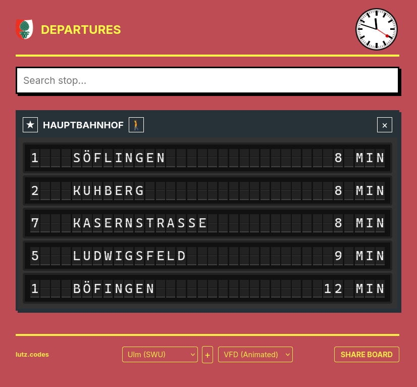

# TramDisplay
A small, dirty, and fast built way to display tram/bus/ÖPNV departures at home for your nearby stops, in (configurable) regions for (configurable) stops all over Germany (or basically everything that the [EFA](https://efa.de/) covers). Initially (and as you might realize) the default values and starting point was only providing departures for Augsburg with an additional backend for [Ulm (SWU)](https://api.swu.de/mobility/). You can add your own backends, but tbh the EFA has everything (including Ulm and Augsburg), so I don't know why I added this. Also, it was planned to be used on an old eReader with a special b/w design, but beware, that such an eReader should actually support modern JS applications...

## Features:
- Configure EFA backend (including using your own EFA endpoints) and filter stops to your region(s) for a much less frustrating stop search
- Set and include walking time to stops
- Using the EFA realtime parameter to check for and show late departures
- 3 different display modes:
  - `VFD (animated)` - airport inspired departure board using funny flip-board animations
  - `VFD (static)` - just a static display without annoying animations
  - `e-Ink` - contrasty b/w display for eReaders/eInk displays
- Configurations stored locally in `localStorage`, also via URL parameters (shareable boards for e.g. bookmarks)
- Dedicated SWU Ulm Backend (but actually unnecessary, maybe as an example how to add a new backend?)
- Cool DACH-style clock

## Setup & Info
- Built with Angular 21.1
- build:
  - `npm install`
  - `ng build`
